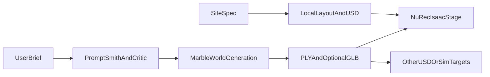

# Architecture

`WorldForge-3D` is a CLI-first bridge between prompt-driven world generation and OpenUSD / Isaac-ready scene artifacts.

## Current Components

- `apps/api/cli.py`: public CLI surface
- `packages/look_agent/`: Marble prompt shaping, generation, export, and credit handling
- `packages/isaac_ready/gaussian_pipeline.py`: PLY sanitization and Isaac conversion
- `packages/site_spec/`: structured Local scaffold contract
- `packages/layout/` and `packages/usd_compose/`: deterministic USD generation
- `packages/sim_qa/`: static validation helpers

## Workflow Map



## Marble Path

The showcase path is:

`WorldBrief -> prompt shaping -> one Marble call -> export -> marble-to-isaac`

Key constraint:

- Marble web viewer quality is higher than the Isaac NuRec integration path

## Local Path

The Local path is:

`SiteSpec -> LayoutComposer -> compose_site -> SimQA`

Key constraint:

- this path produces a deterministic scaffold, not a photoreal world

## Artifact Layout

```text
data/
  worlds/<job_id>/
  gaussian/<scene-name>/
```

## Public Stability

The CLI is the public interface today. Any future API or service layer should preserve the documented command behavior before expanding into a separate runtime surface.
